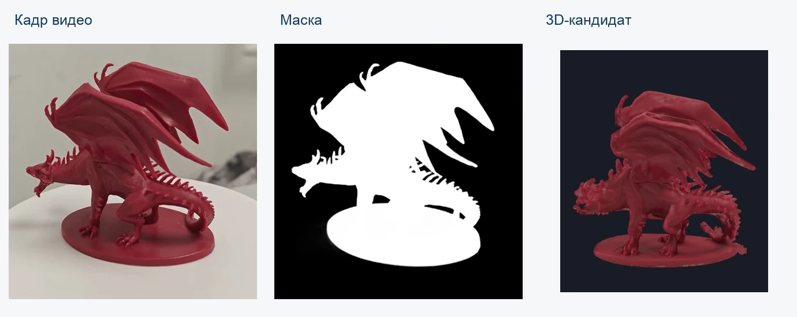
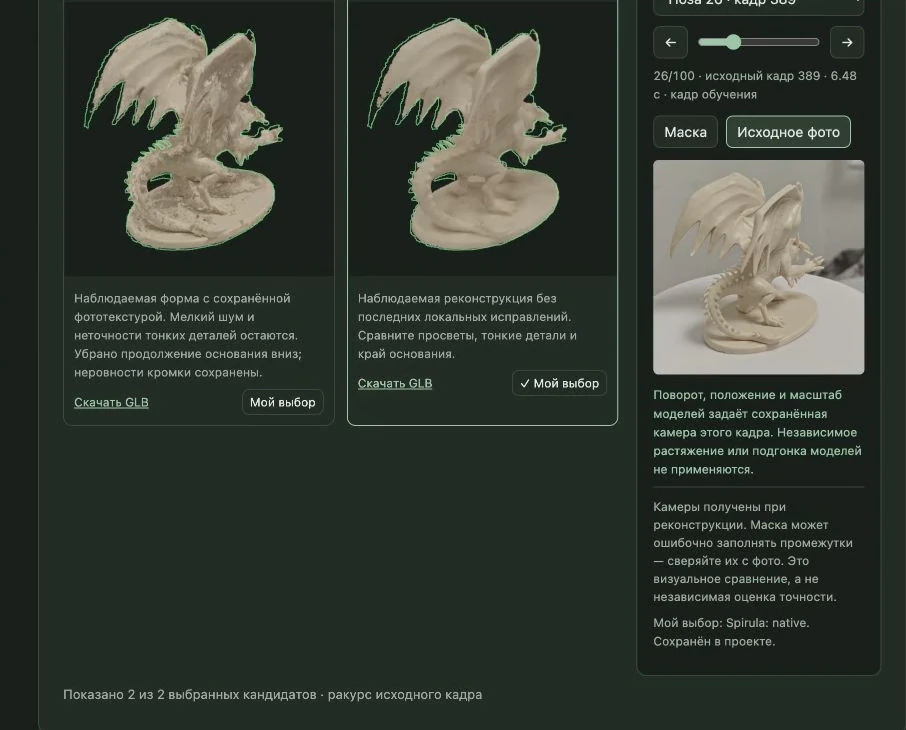
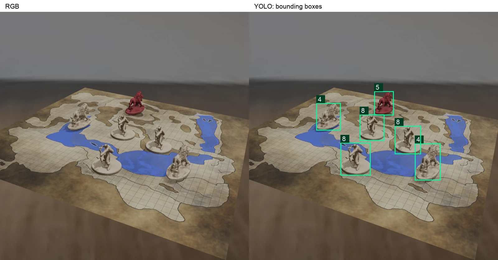
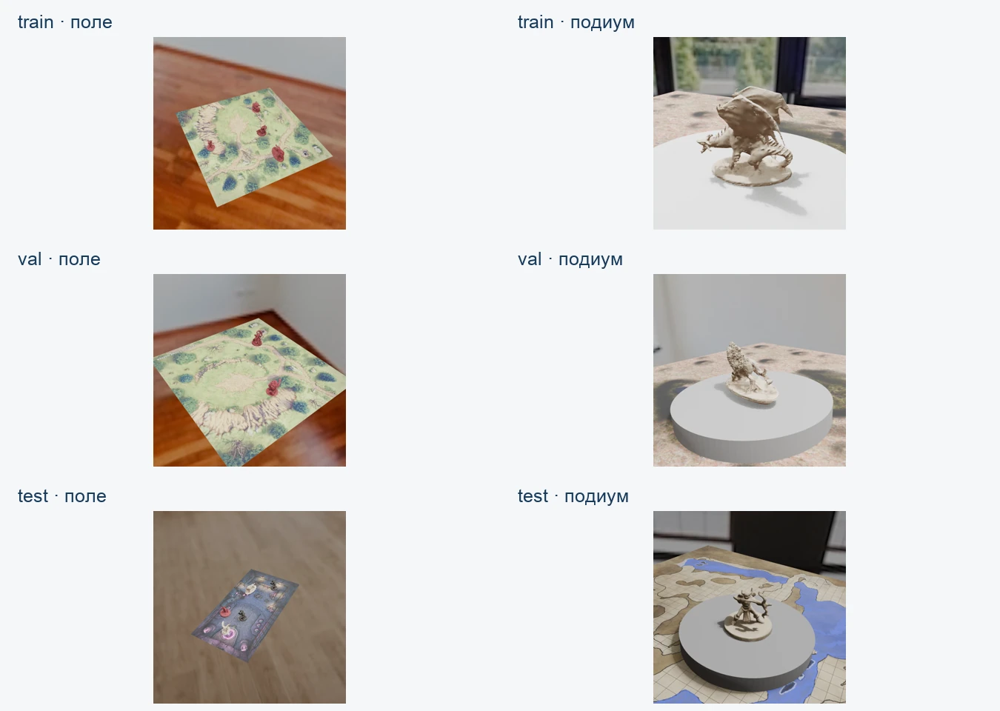
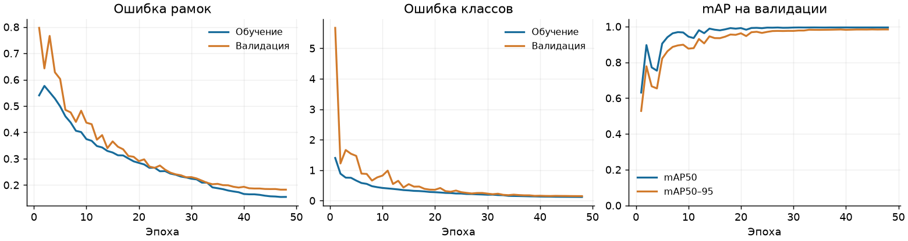
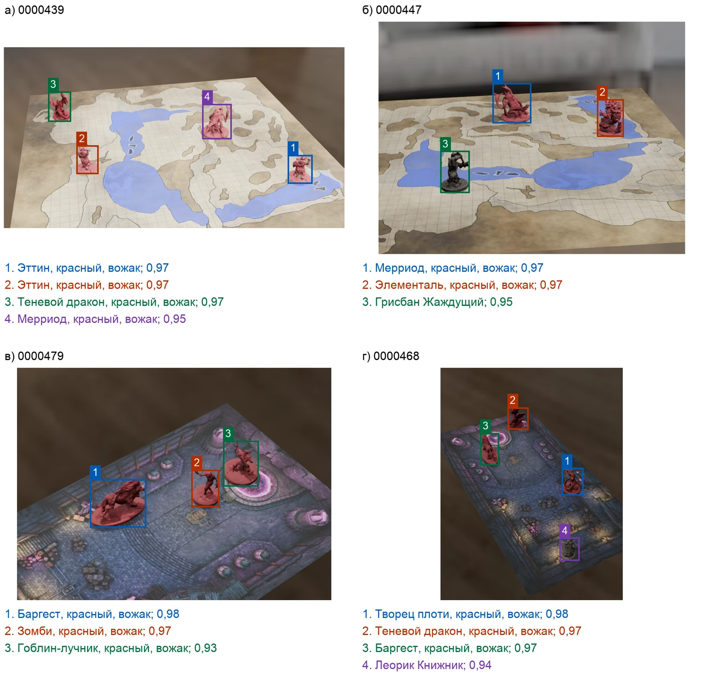

# Анализ видеозаписи настольной игры для проверки соблюдения правил

BoardGen готовит распознаватель фигур для настольной игры
Descent: Journeys in the Dark, Second Edition. Программа строит 3D-модели
по видео фигур, создаёт игровые сцены и обучает на них YOLO.
Обученная модель находит фигуры на поле и определяет их классы.

Отслеживание действий игроков и проверка правил пока не реализованы.

Раздел «Проверка → Координаты и 3D-сцена» показывает, где стоят фигуры.
Для этого нужны параметры камеры, исходная карта, размеры поля
и обученная модель, связанная с выбранными GLB. Программа находит карту
на кадре, восстанавливает положение камеры и подгоняет 3D-модели к рамкам YOLO.
Результат — координаты оснований, вид сверху и 3D-сцена; дополнительное обучение
не требуется. Поворот фигуры оценивается приблизительно. Перекрытия и ошибки
YOLO могут смещать координаты.

Как пользоваться: [docs/localization.md](docs/localization.md).
Два примера и результаты проверки: [research/localization](research/localization/README.md).

## Как работает программа

1. Программа выбирает кадры из видео, на котором фигура вращается.
2. Отделяет фигуру от фона и получает маску её силуэта.
3. Строит варианты 3D-модели. Пользователь сравнивает их с фотографиями
   и выбирает подходящий.
4. Blender создаёт сцены с разными фонами, освещением и ракурсами.
   Программа сохраняет рамку и класс каждой видимой фигуры.
5. Изображения делятся на обучение, валидацию и тест. На валидации выбирают
   настройки, на тесте проверяют итоговое качество YOLO.



Кадр из видео, маска и модель красного Теневого дракона.

Форму можно восстановить через Spirula, Hunyuan3D MV-Turbo или по силуэтам.
Spirula использует несколько ракурсов, MV-Turbo — четыре проверенные стороны.
Силуэты дают приблизительную форму без скрытых углублений. Все три метода
могут терять тонкие детали. Готовую модель можно покрыть текстурой
из фотографий или оставить с нейтральным материалом.



Перед выбором модели в интерфейсе можно проверить её форму и текстуру.
Галерея содержит 53 варианта для 26 фигур. Для итогового эксперимента
взяли 10 вариантов Spirula, два MV-варианта с фототекстурой и белого Баргеста
с геометрией красной парной фигуры. В описаниях моделей указаны их происхождение
и сделанные исправления.



Слева — сцена Blender, справа — рамки фигур с номерами классов.
В рамку попадает видимая часть фигуры; тени и скрытые части в неё не входят.



В итоговом эксперименте 70% сцен созданы на поле, 30% — на подиуме.
10% сцен пустые. На поле стоят 2–6 фигур. Для теста использованы другие фоны,
чем для обучения и валидации. Модели фигур и их текстуры во всех частях общие.

[Демонстрация](docs/media/boardgen-demo.mp4)

## Результаты эксперимента

YOLO проверена на изображениях из Blender. На записи реальной партии
качество ещё не измеряли. Из 26 фигур коллекции в эксперимент вошли
13 классов — с учётом доступных вычислительных ресурсов.

<!-- research-metrics:start -->
| Параметр | Значение |
|---|---|
| Коллекция / классы эксперимента | 26 / 13 |
| Изображения, всего | 2438 |
| Обучение / валидация / тест | 1798 / 320 / 320 |
| Модель / завершённые эпохи | YOLO11s / 48 |
| mAP50 | 0,8989 |
| mAP50–95 | 0,8143 |
| Макро-F1 при рабочем пороге | 0,8107 |
| Точность / полнота при рабочем пороге | 0,7081 / 0,8772 |
<!-- research-metrics:end -->

Точность — доля правильных распознаваний среди найденных фигур.
Полнота — доля найденных фигур среди всех фигур на кадрах. F1 объединяет
эти показатели, а макро-F1 даёт каждому классу одинаковый вес.
mAP оценивает результат при разных порогах уверенности.
mAP50–95 предъявляет более строгие требования к совпадению рамок, чем mAP50.

По валидации выбраны настройки: изображение 960 пикселей, порог уверенности
0,50, NMS IoU 0,45 и IoU сопоставления 0,50. NMS удаляет повторные рамки,
IoU измеряет совпадение рамки с разметкой. AP рассчитана с нижним порогом 0,001.
Точность, полнота и макро-F1 в таблице рассчитаны при рабочем пороге;
на валидации макро-F1 составила 0,9952. Из 2440 созданных изображений
удалены два точных дубликата в обучении.



На графике — сохранённая история 48 эпох обучения.



На примерах показаны рамки, классы и уверенность при пороге 0,50.
Метрики в таблице рассчитаны по всему тесту.

## Установка и запуск

Полный процесс рассчитан на macOS Apple Silicon. Для запуска нужны
Python 3.13, `uv`, FFmpeg в `PATH` и поддержка Metal. Для проверки интерфейса —
Node.js/npm. Python-тесты на CPU запускаются и в Linux CI,
но работа всех внешних методов на Linux не проверена.

Из корня репозитория:

```bash
make setup-full
make setup-tools
make studio PROJECT=/absolute/path/to/project
```

`setup-full` устанавливает Python-зависимости из `uv.lock`.
`setup-tools` скачивает закреплённые версии Blender, Spirula, OpenMVS,
Hunyuan3D-Swift и веса MV. BiRefNet отделяет фигуру
от фона без обучения на наших фигурах; при первом запуске может потребоваться
загрузка из Hugging Face.

Откройте http://127.0.0.1:8769/.

1. В разделе «Проект» подключите видео и проверьте окружение.
2. В «Подготовка фигур» получите кадры и маски, проверьте ракурсы и создайте модель.
3. В «Сравнение и выбор» выберите модель, затем задайте фоны и параметры сцен.
4. Создайте пробные изображения, соберите датасет и запустите обучение и оценку.

Проверить настройки можно из терминала:

```bash
make doctor PROJECT=/absolute/path/to/project
.venv/bin/boardgen-project --project /absolute/path/to/project validate
```

Подробнее: [настройки и команды](docs/configuration.md),
[пример проекта](docs/project.example.yaml), [схема настроек](docs/project.schema.json).

## Как устроен код

Интерфейс и команды терминала работают с одними настройками и очередью заданий.
Долгие операции запускаются в фоне. Каждый запуск сохраняет отдельную версию
результата с параметрами и контрольными суммами файлов. Новые настройки
не заменяют уже выбранную модель.

Код в `src/boardgen/` разделён по задачам:

- `studio/` — веб-интерфейс, настройки проекта, очередь, хранение результатов и обучение.
- `video/` — чтение видео, выбор кадров и отделение фигур от фона.
- `camera/` — параметры камер и проверка ракурсов.
- `reconstruction/` — построение формы по силуэтам.
- `methods/` — внешние методы восстановления и исправления моделей.
- `rendering/` — создание сцен в Blender и автоматическая разметка.
- `evaluation/` — сравнение 3D-моделей и расчёт качества распознавания.
- `common/` — общие функции для изображений, имён фигур и контрольных сумм.
- `maintenance/` — установка внешних программ, сценарии эксперимента и проверки результатов.

В корне пакета — его описание и вход в командную строку.
Этапы работы и сохранение результатов описаны в [docs/contracts.md](docs/contracts.md).

## Данные и остальные папки

- `data/board/` — изображения игровых полей для фонов сцен.
- `data/skybox/` — панорамные изображения окружения для сцен.
- `metadata/` — названия фигур и их связь с исходными видеозаписями.
- `research/` — исходные видео и сохранённые результаты экспериментов;
  назначение поддиректорий описано в [research/README.md](research/README.md).
- `docs/` — инструкции, примеры настроек, изображения и демонстрация.
- `tests/` — проверки Python и веб-интерфейса.

Фоны проверяются по SHA256 — контрольной сумме содержимого. Так программа
находит одинаковые файлы даже с разными именами. После поворота или обработки
изображения сумма меняется; такие варианты нужно вручную оставлять в одной выборке.

## Проверки

```bash
make check
make studio-check
make audit-pipelines
.venv/bin/python -m boardgen.maintenance.verify_research_assets
```

Команды проверяют код, интерфейс, связи модулей и сохранённые результаты
без переобучения и скачивания весов.
`.venv/bin/python -m boardgen.maintenance.research_report --write` обновляет
таблицу и график по сохранённому отчёту.
