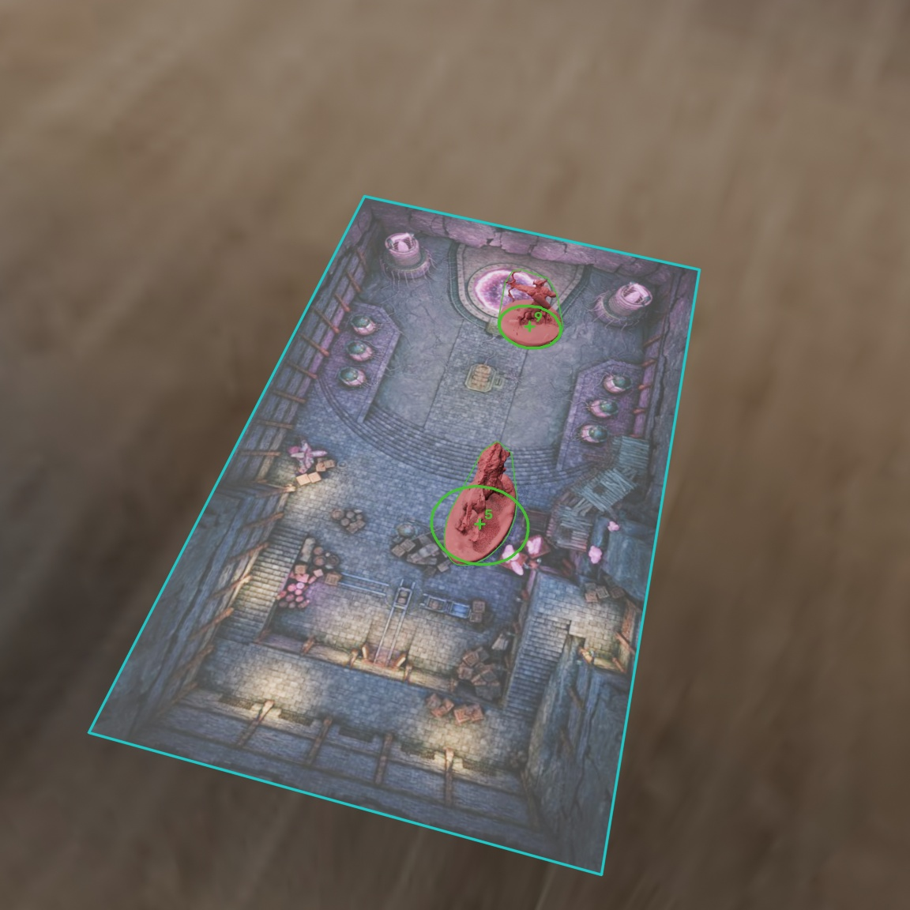
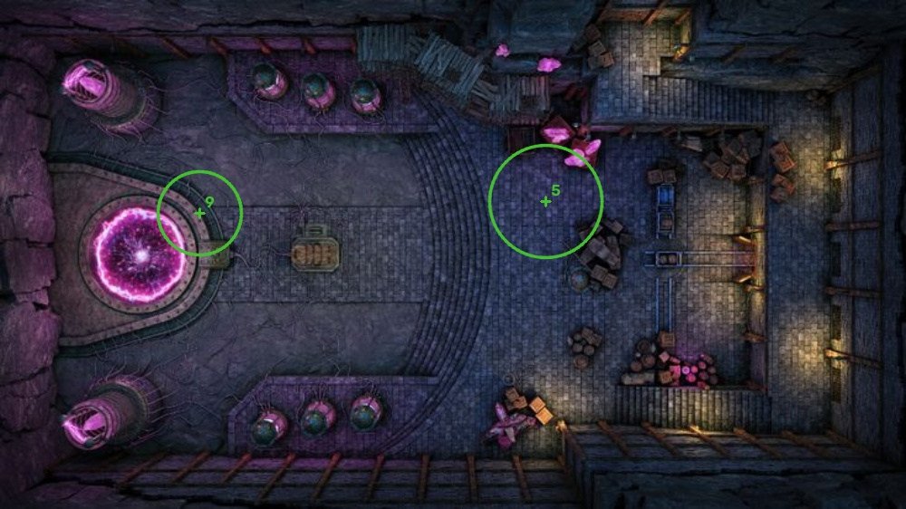
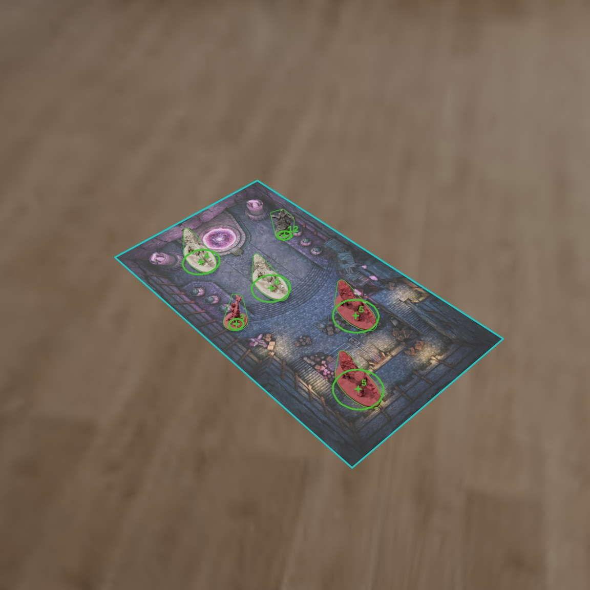
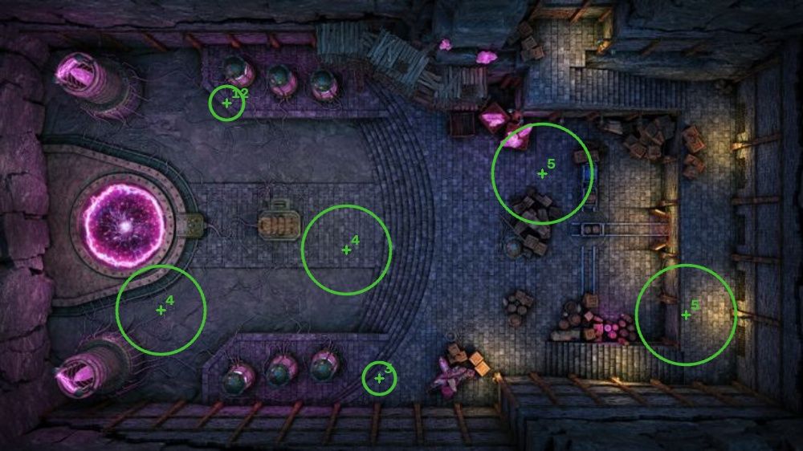

# Координаты фигур: результаты и примеры

Программа находит карту на фотографии и вычисляет положение камеры.
Подгоняет выбранные GLB к рамкам YOLO11s и получает координаты фигур.
Внутренние параметры камеры и размеры поля нужно указать заранее.
Модель работает без переобучения.

## Два примера

Слева бирюзовой линией обведено поле, зелёными контурами — проекции моделей.
Круги показывают основания фигур, кресты — их центры. Числа — классы YOLO.
Справа эти же положения отмечены на исходной карте.

| Кадр с наложением | Вид сверху |
| --- | --- |
|  |  |
|  |  |

В первом примере ошибки координат центров — 0,10 и 0,58 мм,
во втором — от 0,07 до 3,77 мм.
[Координаты, радиусы и классы этих кадров](examples/coordinates.json).

## Проверка точности

Для проверки координат взяты 22 непустых кадра из тестовой части датасета.
На них YOLO находит все фигуры без лишних обнаружений, правильно определяет
классы, а IoU каждой рамки не ниже 0,85. Порог уверенности — 0,50.
В проверку вошли все 13 классов.

| Камера | Обработано кадров | Фигур | Медиана ошибки | 90-й процентиль | Максимум |
| --- | ---: | ---: | ---: | ---: | ---: |
| Эталонная Blender, проверка подгонки | 22 / 22 | 74 | 1,08 мм | 4,83 мм | 10,62 мм |
| Восстановлена по изображению карты | 20 / 22 | 67 | 1,21 мм | 5,77 мм | 10,70 мм |

Если перенести нижний центр рамки на плоскость поля, медианная ошибка
на тех же 67 фигурах составит 18,40 мм. На кадрах `image_0000442`
и `image_0000443` не хватило совпадений с картой для определения камеры.
Для них координаты не рассчитаны; поле можно задать вручную по четырём углам.

За эталон принят центр основания той же GLB при её известном положении
в сцене. Основание вычислено по геометрии модели; физические фигуры отдельно
не измерялись. Поворот определяется приблизительно: разным ориентациям могут
соответствовать похожие рамки. Перекрытия, неверный класс и пропуски YOLO
влияют на результат. Точность на всём датасете и реальных фото здесь не измерялась.

[Сводка с SHA256 входов и ошибками по кадрам](results.json).

## Время обработки

Время замерено на CPU после двух прогревочных запусков. Размер кадра —
1152 × 1152, YOLO `imgsz=960`. Для 20 кадров, на которых удалось определить
камеру, среднее время — 0,43 с, медиана — 0,39 с, 90-й процентиль — 0,58 с,
максимум — 0,65 с. В замер входят чтение кадра, запуск YOLO, определение камеры
и подгонка фигур. Загрузка моделей, сохранение превью и работа интерфейса
не учтены. Начальная загрузка заняла около 2 с, первый запуск YOLO — около
0,67 с. Время зависит от компьютера и числа фигур.

[Подробный замер времени](latency-cpu.json).
Как запустить систему и повторить эксперимент:
[инструкция по локализации](../../docs/localization.md).
